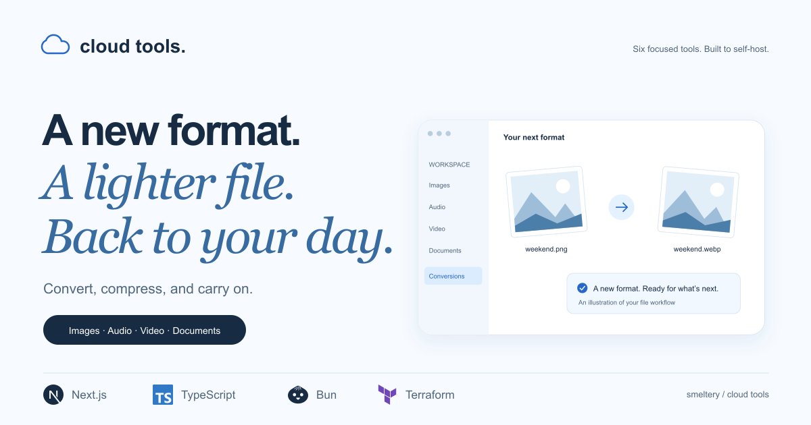

#  Cloud Tools

Convert images, audio, video, and eBooks. Compress images and PDFs. A practical, self-hostable file toolbox from Smeltery.

[](https://github.com/smeltery/cloud-tools/actions/workflows/ci.yml)
[](https://github.com/smeltery/cloud-tools/releases)
[](https://nextjs.org)
[](https://www.typescriptlang.org)
[](https://bun.sh)
[](https://flox.dev)
[](https://www.terraform.io)
[](LICENSE)



## Use the tools

1. Choose an image, audio, video, or eBook converter—or image/PDF compression.
2. Upload a file and choose its output format, or start compression.
3. Follow the job’s progress and download the finished file. Keep your original until you’ve checked the result.

Files are processed by the installation’s worker, not entirely in your browser. See [formats](docs/formats.md), [jobs and downloads](docs/jobs.md), and [file handling](docs/conversion.md).

## Run locally

Install [Flox](https://flox.dev/docs/install-flox/), then:

```sh
git clone https://github.com/smeltery/cloud-tools.git
cd cloud-tools
flox activate
bun install --frozen-lockfile
bun run dev
```

Open `http://localhost:3000` to preview the interface. **For working uploads and conversions**, follow the [quick start](docs/quick-start.md) to start Docker/LocalStack, provision storage and queues, and run the worker. See [self-hosting](docs/deployment.md) for AWS deployment.

## Documentation

Start in [docs/](docs/README.md): [using the tools](docs/conversion.md), [formats](docs/formats.md), [API](docs/api.md), [architecture](docs/architecture.md), [self-hosting](docs/deployment.md), and [contributing](docs/development.md). The same guides are served at `/docs`.

Run `bun run hooks:install` to enable the local CI checks. See [development](docs/development.md) for validation, LOC budgets, and automatic releases.

Licensed under [PolyForm Shield 1.0.0](LICENSE).
