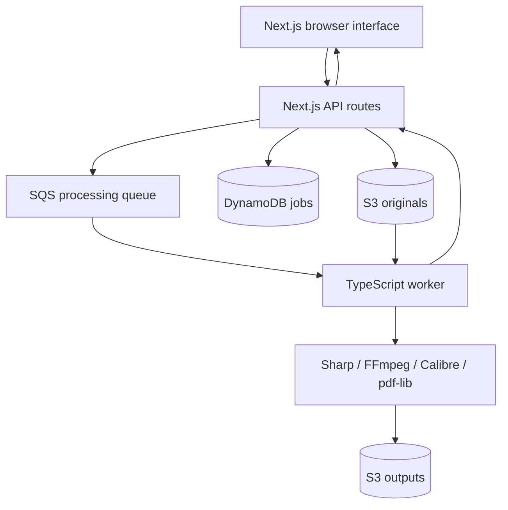
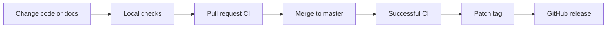

# Architecture

A browser interface over an asynchronous file-processing pipeline.

## Components

`client/` owns pages, components, API routes, and tests. `lib/aws-config.ts` supplies shared clients and resource names. `lib/worker.ts` polls SQS and delegates to file processors. `scripts/worker.ts` loads configuration and starts the worker.

## Infrastructure

`infrastructure/` contains Terraform modules for storage, queues, IAM, monitoring, the API gateway, and Lambda scaffolding. Local development uses LocalStack. The standalone worker and Lambda scaffolding are distinct execution paths; validate engine packaging and permissions before choosing a deployment.

## Documentation

The website renders the curated Markdown files in `docs/` at build time. A shared catalog supplies sidebar and search entries. Mermaid diagrams render lazily in the browser and are syntax-checked in CI. Navigation, footer, and branding are shared components.

## Development and releases

Bun installs the workspace; Node runs Next.js and Vitest. Flox locks system tools for local work and CI. A release is cut only for the exact successful default-branch revision. See [contributing](development.md).
