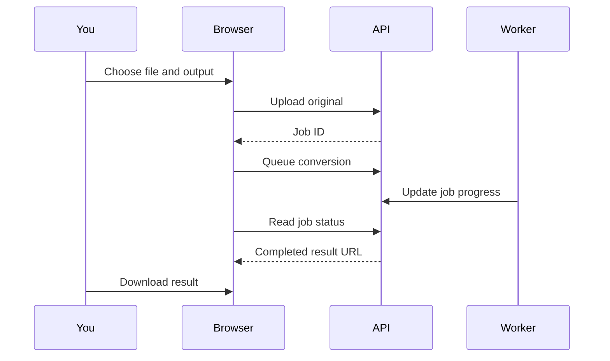

# Converting files

Choose the tool that matches your input, then pick the result you need.

## Choose your tool

The toolbox has four converters: image, audio, video, and eBook. Image and PDF compression are separate tools. The format picker shows the output formats offered by that tool; the worker's installed engines determine what can actually be decoded.

## Upload and configure

Select a file from your computer. For conversion, choose a target format different from the input. For compression, use the compression tool directly. The current interface uses a default quality of 80 for compression.

Files leave your device and are stored by the installation you are using. Confirm the operator's policy before uploading private material. Large uploads may hit your host's request-size or timeout limits.

## Follow the result

Keep the job ID shown after upload. The Jobs page reads server records; recent conversion history is also kept in this browser's local storage. A queued job is not a finished conversion.

## Check your output

Open the downloaded file before deleting your original. Lossy formats can change quality. PDF optimization may not shrink every document, and image compression savings depend on the original. Conversion support varies by codec, source file, and engine installation.
