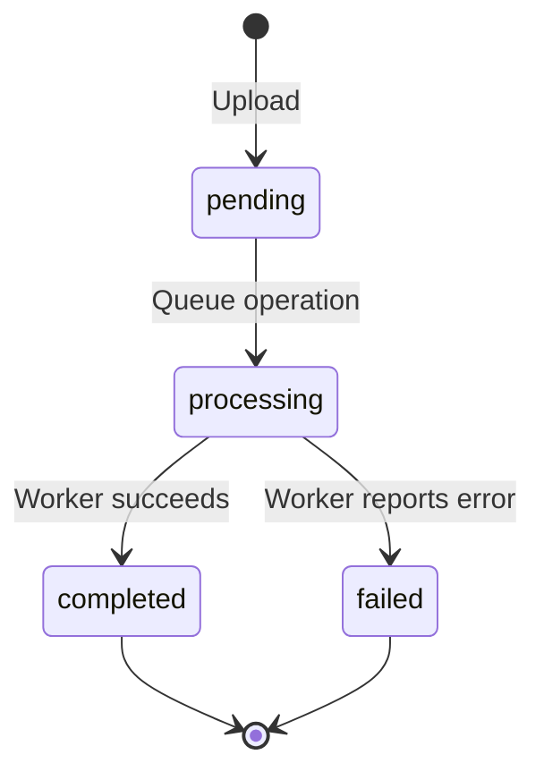

# Jobs and downloads

A job connects your original file, requested operation, status, and output.

## Job lifecycle

The process endpoint marks a queued job as processing. That state does not prove the worker has picked it up yet. A job with no progress may be waiting for a worker or a native conversion engine.

## Find a job

Use the Jobs page or `GET /api/jobs?jobId=YOUR_JOB_ID`. The response includes status and, when available, progress and download URL. A missing record returns 404. Listing jobs is installation-wide, not isolated per user.

The Jobs page combines recent history from the six tools on this browser. Select a file or paste a job ID to fetch its current status. Active jobs can refresh every ten seconds while the page is visible; turn off the checkbox to check manually. A failed check pauses automatic refresh and labels any previous result as stale. Recent shortcuts are local to this browser, not an installation-wide job list.

## Download a completed file

Wait for `completed` and use the returned `downloadUrl`. The URL points at configured storage. Accessibility depends on endpoint reachability and bucket access settings; the current worker does not issue expiring signed URLs.

## Failure and cancellation

A failed job may include an error message. Fix the underlying issue before resubmitting. Avoid repeatedly queuing the same job: requests are not idempotent.

The current cancellation endpoint updates a status record but does not actually remove an SQS message or stop a running conversion. Do not rely on it for cancellation. Queue count values returned by the process endpoint are placeholders rather than live metrics.

## Retention

There is no application-wide deletion deadline. Storage lifecycle rules and database TTL configuration control retention. Browser history is separate from storage and clearing it does not delete uploaded files.
